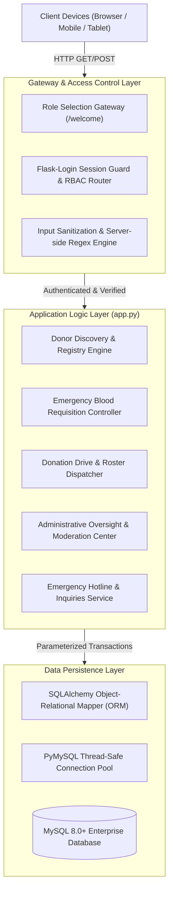
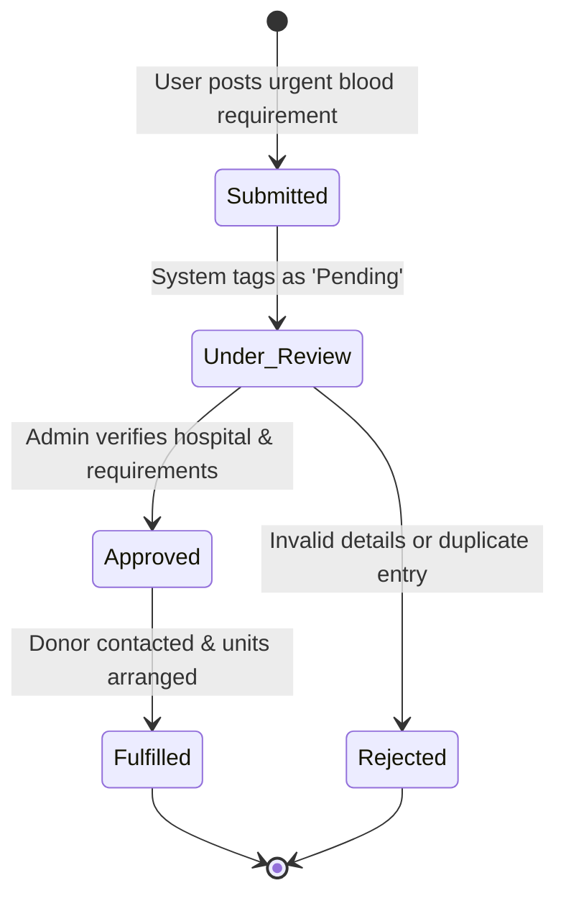
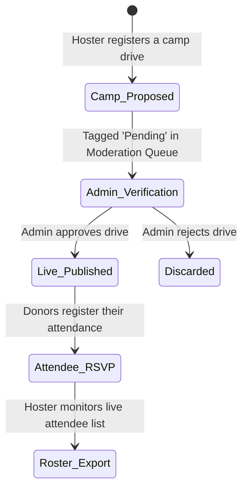
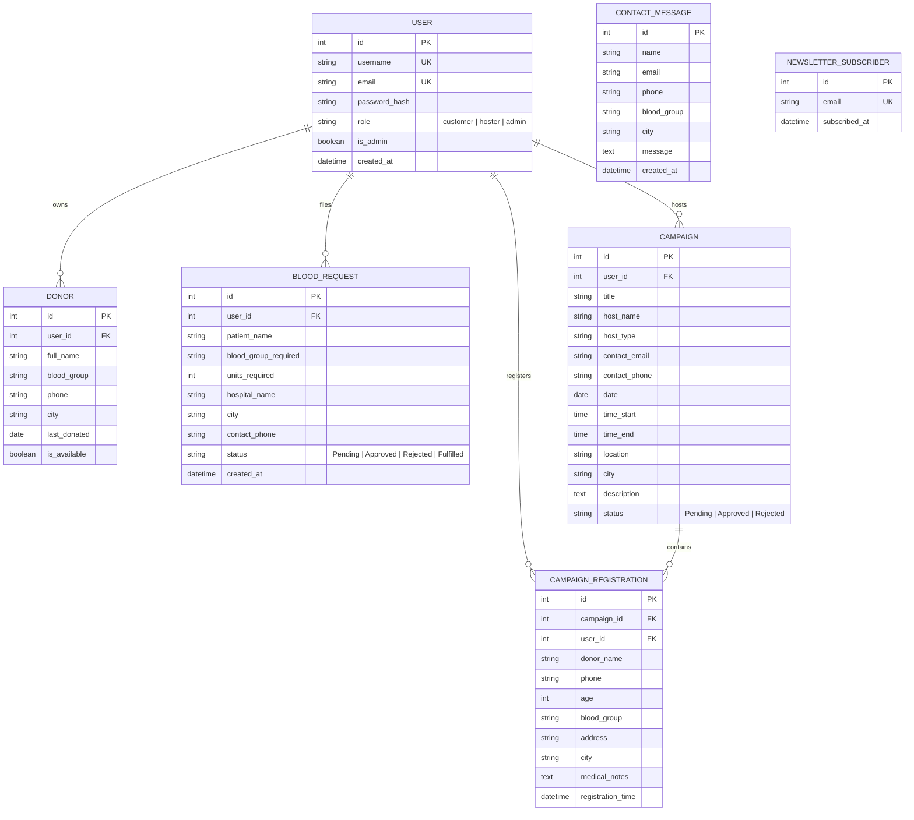

# BloodBridge — Comprehensive Enterprise System Architecture & Specification

---

## 1. Executive Summary & Vision

**BloodBridge** is a modern, enterprise-grade, server-side rendered Blood Donation Logistics and Emergency Requisition Platform. In healthcare emergencies, every second counts. Traditional systems often suffer from fragmented communication, unverified donor leads, and lack of accountability between hospitals, individual donors, and camp organizers.

BloodBridge bridges these communication gaps through:
- **Zero-Latency Donor Matching:** Real-time filtered discovery of voluntary donors by blood group and location.
- **Emergency Life Requisitions:** Real-time patient requirement broadcasting with structured administrative approval workflows.
- **End-to-End Campaign Lifecycle:** Tools for institutional hosts (universities, hospitals, NGOs) to schedule, broadcast, and manage attendee rosters for blood drives.
- **Strict Role-Based Isolation:** Complete operational and data separation across **Public/Guests**, **Donors/Patients (Customers)**, **Organizers (Hosters)**, and **Super-Administrators**.

---

## 2. Industry Architecture & System Topology

The platform is designed following the **Model-View-Controller (MVC)** architectural pattern, enforcing strict separation of concerns, defensive programming, and zero reliance on mock client-side state.



---

## 3. User Roles & Access Control Matrix (RBAC)

BloodBridge implements defense-in-depth Role-Based Access Control (RBAC). A user cannot access unauthorized endpoints or perform cross-role actions.

| Feature / Action | Public / Guest | Customer (Donor / Patient) | Hoster (Camp Organizer) | Administrator |
|:---|:---:|:---:|:---:|:---:|
| **Welcome Role Gateway** | Full Access | Full Access | Full Access | Full Access |
| **Search Verified Donors** | Read-Only | Read-Only (Direct WhatsApp / Call) | Read-Only | Read / Manage |
| **Register as a Donor** | Requires Login | Full Access | Prohibited | View / Edit |
| **Submit Blood Emergency** | Requires Login | Full Access | Prohibited | View / Moderate |
| **Track Own Requests** | Prohibited | Full Access (`/my_requests`) | Prohibited | View All |
| **Host a Blood Donation Drive** | Requires Login | Prohibited | Full Access (`/host_drive`) | Full Access |
| **View Camp Attendee Rosters** | Prohibited | Prohibited | Full Access (Own Camps) | Full Access (All Camps) |
| **Register Attendee for Camp** | Requires Login | Full Access | Full Access | Full Access |
| **Emergency Requisition Approval** | Prohibited | Prohibited | Prohibited | Approve / Reject / Fulfill |
| **Camp Drive Moderation** | Prohibited | Prohibited | Prohibited | Approve / Reject |
| **Administrative Dashboard** | Prohibited | Prohibited | Prohibited | Full Access (`/admin`) |

---

## 4. End-to-End Business Flow & Lifecycles

### 4.1 Emergency Blood Requisition Lifecycle


1. **Requisition Filing:** An authenticated user enters patient details, hospital name, required blood group, units, and emergency contact.
2. **Admin Moderation:** The request lands in the administrative review queue with status `Pending`. An administrator reviews the credentials and marks the request `Approved` or `Rejected`.
3. **Public Discovery:** Once approved, the emergency request is visible across live emergency channels, allowing nearby voluntary donors to respond immediately.
4. **Fulfillment:** Once units are secured, the status is updated to `Fulfilled`.

---

### 4.2 Blood Drive & Campaign Lifecycle


1. **Camp Submission:** Authorized institutions (Colleges, Hospitals, NGOs, Corporates) submit a proposed camp with date, venue, timings, and contact info.
2. **Verification & Publication:** Admin reviews the proposal to prevent fraudulent drives. Upon approval, the camp becomes public on the landing page and campaign directory.
3. **Citizen RSVPs:** Registered donors sign up for the camp, providing their age, blood group, address, and any prior medical notes.
4. **Organizer Roster Monitoring:** Organizers inspect live attendee lists via `/campaign/<id>/registrations` to prepare supplies and logistics.

---

## 5. Database Schema & Data Dictionary

The persistence layer uses MySQL 8.0+ with strict foreign key constraints and UTF-8 multi-byte encoding (`utf8mb4`).

### Entity Relationship Diagram


---

## 6. Enterprise Security & Hardening Standards

1. **Zero Secret Leakage:** 
   - No passwords or connection strings are hardcoded in the codebase.
   - All sensitive configurations are managed through `.env` and kept out of version control via `.gitignore`.
2. **Cryptographic Password Security:** 
   - User passwords are never stored in plaintext. They are protected using `scrypt` / `pbkdf2:sha256` salt-hashed representations via `werkzeug.security`.
3. **Session & Cookie Hardening:**
   - `SESSION_COOKIE_HTTPONLY = True` (prevents client-side scripts from reading session cookies).
   - `SESSION_COOKIE_SAMESITE = 'Lax'` (mitigates Cross-Site Request Forgery).
   - Max payload restriction enforced (`16 MB`).
4. **SQL Injection Immunization:**
   - 100% of queries use SQLAlchemy ORM with parameterized statements. Raw concatenated SQL queries are strictly prohibited.
5. **Cross-Site Scripting (XSS) Prevention:**
   - Jinja2 engine auto-escapes all untrusted outputs across all HTML templates.
6. **Strict Input Validation:**
   - Server-side regex validation for emails (RFC 5322), 10-digit phone numbers, and strong passwords.

---

## 7. Production Deployment & Operational Guidelines

### Recommended Production Stack
- **Web Server:** Nginx (Reverse Proxy, SSL Termination, Rate Limiting)
- **WSGI Application Server:** Gunicorn or uWSGI (Multi-worker process management)
- **Database Server:** MySQL 8.0+ or AWS RDS / Cloud SQL with managed automated backups
- **Application Runtime:** Python 3.11+ in a dedicated virtual environment

```bash
# Example Production Gunicorn Startup Command
gunicorn -w 4 -b 0.0.0.0:5000 wsgi:app
```
